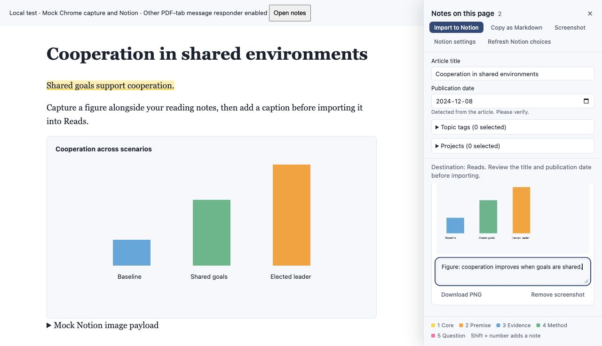
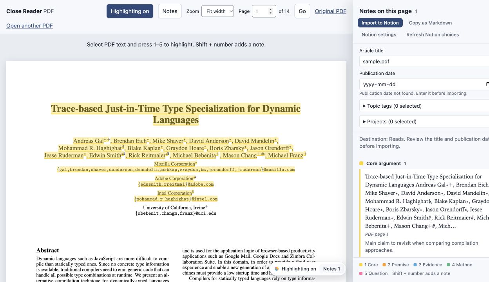
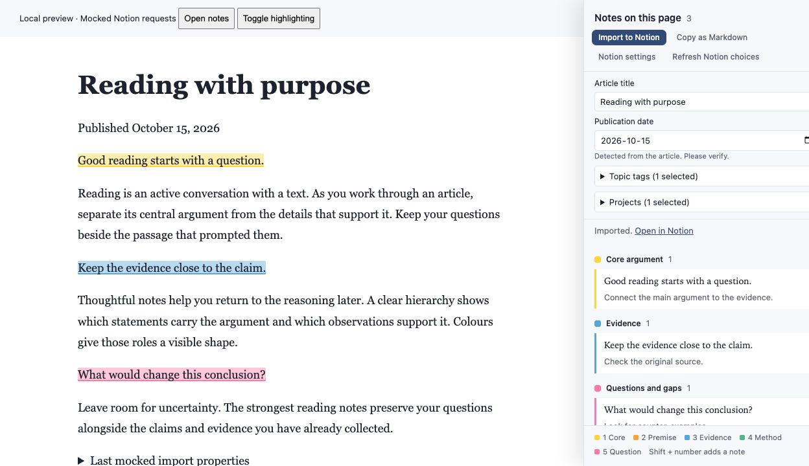

# Close Reader

Highlight articles and PDFs, keep your thinking beside the text, and turn reading notes into Notion pages.

Close Reader is a browser extension for close reading: five highlight colours, attached notes, Markdown copying, and a notes panel you can keep open while reading. Designed for Chrome and Chromium browsers such as Arc, Brave, and Edge.

[Install](#install) · [Shortcuts](#shortcuts) · [PDFs](#pdfs) · [Notion](#notion) · [Screenshots](#screenshots) · [Full preview guide](https://github.com/albertyqw/highlighter/blob/feat/reads-import-reader-layout/close-reader/README.md)

> **Development preview:** PDF reading, screenshot notes, side-by-side reading, and the Reads database import are on the [development branch](https://github.com/albertyqw/highlighter/tree/feat/reads-import-reader-layout), in [PR #2](https://github.com/albertyqw/highlighter/pull/2). `main` currently contains web highlighting, notes, Markdown copying, and the original Notion page import. The screenshots below show the development preview using demonstration content and mocked Notion responses.



## What it does

| Feature | On `main` | Development preview |
| --- | --- | --- |
| Five-colour highlights and notes on web pages | Yes | Yes |
| Copy notes as Markdown | Yes | Yes |
| Import to Notion | New child page | Reads database, with metadata and existing tags/projects |
| Reserve reading space beside rolling notes | — | Yes |
| Read and highlight web or local PDFs | — | Yes |
| Capture figures, add captions, and export images | — | Yes |

## Install

There is no build step. Load the extension's `close-reader` folder directly.

### Try the development preview

1. [Download the preview ZIP](https://github.com/albertyqw/highlighter/archive/refs/heads/feat/reads-import-reader-layout.zip) and extract it somewhere permanent.
2. Open `chrome://extensions` and enable **Developer mode**.
3. Click **Load unpacked** and select the **close-reader** folder inside the extracted repository. This is the folder containing `manifest.json`.
4. Pin Close Reader to the browser toolbar and refresh any article tabs that were already open.
5. Click the extension icon, select text, and press **1–5** to highlight.

To use the code on `main`, [download the main-branch ZIP](https://github.com/albertyqw/highlighter/archive/refs/heads/main.zip) and follow the same steps. See its [included guide](close-reader/README.md) for the original Notion page setup.

### Update without losing your local setup

Replace the files in the **same extension folder you originally loaded**, then click **Reload** on that extension's entry. Refresh article tabs and close/reopen all Close Reader PDF tabs.

Loading another folder as a separate unpacked extension can give it a different identity, with separate notes and connection settings. Keep the original folder path when updating.

## Highlight with purpose

| Key | Colour | Reading role |
| --- | --- | --- |
| **1** | Yellow | Core argument, thesis, conclusion, or main idea |
| **2** | Orange | Supporting premises and qualitative claims |
| **3** | Blue | Evidence, data, and statistics |
| **4** | Green | Methods, techniques, and definitions |
| **5** | Pink | Questions, gaps, counterarguments, and things to investigate |

Select a passage, then press a number or choose a colour from the floating palette. **Shift + number** also opens a note. Click an existing highlight to edit its colour or note, or delete that highlight.

Highlights save per source and return when you revisit it. Open **Notes** to review your quotes and thoughts; click an entry to jump back to its passage.

## Shortcuts

| Action | Windows / Linux | Mac |
| --- | --- | --- |
| Toggle highlighting | Alt + Shift + H | Option + Shift + H |
| Open or close notes | Alt + Shift + N | Option + Shift + N |
| Start screenshot capture *(preview)* | Alt + Shift + S | Option + Shift + S |
| Highlight selected text | 1–5 | 1–5 |
| Highlight and add a note | Shift + 1–5 | Shift + 1–5 |

Change extension shortcuts at `chrome://extensions/shortcuts`. Close Reader's toolbar icon also toggles highlighting.

## PDFs

*Development preview.* Open a PDF and click Close Reader. It opens in the extension's own PDF reader, with selectable text, fit-width/zoom controls, page navigation, and the same highlight colours and notes. Opening the notes panel refits the PDF into the remaining reading space.

For PDF download links without a `.pdf` suffix, right-click the link and choose **Open PDF in Close Reader**. For local files, choose a PDF through the reader's file picker; it stays on your computer.

Notes are anchored to PDF pages. Markdown and Notion imports include page references. Annotations stay in the extension; the original PDF file is unchanged. Scanned or image-only PDFs need OCR before text highlighting can work.



## Notion

### Reads database import — development preview

1. Open **Notion settings** in the notes panel.
2. Create a [Notion internal connection](https://www.notion.so/profile/integrations) with **Read content** and **Insert content** capabilities.
3. Add that connection to your **Reads** database through its **Connections** menu.
4. Save the token in the extension. It finds a database named Reads, or you can specify its database link.
5. Review the article title and publication date, select existing topic tags/projects, then click **Import to Notion**.

Reads needs these properties:

| Property | Notion type |
| --- | --- |
| Title, or another title property | Title |
| Date | Date |
| Topic Tags | Multi-select |
| Project | Multi-select |

The publication date is detected from explicit publisher metadata when available and remains editable. Enter a missing date manually; PDF creation dates and the date you imported the notes are not used as substitutes.

Each import creates a new Reads entry. Main ideas become outermost bullets, supporting highlights nest beneath the preceding main idea, and colours are preserved using Notion background colours. Captured screenshots become image blocks with captions and PDF references. Imports are manual, rather than continuous sync.

If an import stops partway through, open the linked partial page before retrying to avoid duplicate entries. **Refresh Notion choices** reloads tags and projects. The browser extension needs its own saved connection token, separately from any Notion connection inside Codex.



## Screenshots

*Development preview.* Click **Screenshot** and drag around a diagram, table, or other area. Choose **Capture visible page** for the viewport, or press **Esc** to cancel.

Each capture has an editable caption, **Download PNG**, and **Remove screenshot**. Captures save locally alongside their source and can be included in a Notion import, even without text highlights.

If Chrome needs temporary capture access, start with **Alt/Option + Shift + S** or the extension icon's **Capture a screenshot for notes** context menu. For long pages, capture another area after scrolling; full-document stitching is not implemented.

Markdown contains image links matching the downloaded PNG filenames. Keep those PNGs beside the Markdown when moving your notes to another editor.

## Local storage and privacy

- Text highlights and notes are saved in local extension storage. Preview screenshots use local IndexedDB. They are not synced between browsers.
- The Notion token is stored locally, without encryption or browser sync. Never commit a token to the repository.
- Imports go directly to Notion. Selected quotes, notes, metadata, and captures are sent when you click Import; original PDF files are not uploaded.
- Web PDF downloads request access to their source site as needed. Local PDF files use the file picker.
- The PDF renderer and its supporting assets are bundled with the extension; no executable code is loaded from a CDN.

## Development

Load `close-reader/` unpacked to run it. With Node.js installed, run the tests from the repository root:

```sh
node --test tests/*.test.cjs
```

The development preview includes 39 tests covering Notion payloads, PDF source identity, page messaging, capture geometry, and failure handling. Notion and Chrome API responses are mocked in automated tests; test passes do not replace a live workspace check.

The preview bundles [Mozilla PDF.js](https://mozilla.github.io/pdf.js/). Its version, licenses, and vendoring instructions are recorded in [the PDF.js directory](https://github.com/albertyqw/highlighter/tree/feat/reads-import-reader-layout/close-reader/vendor/pdfjs).

## Known limits

- Browser settings pages and the extension store block ordinary page highlighting.
- Changed article text may prevent a saved highlight from reattaching; its quote and note remain saved.
- Single-page apps may need a refresh after navigating to a different article.
- Unusual fixed layouts, embedded frames, and canvases may not reflow like normal article pages.
- If a PDF site's authentication or download restrictions prevent loading, download the PDF and choose it locally.
